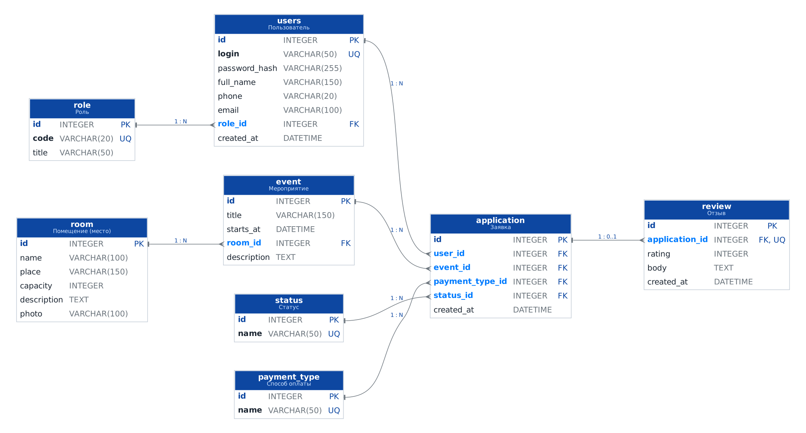

# Практическая работа № 2. Проектирование базы данных. ER-диаграмма

**Студент:** Самотлягин, группа 4ИСП9-45

| Файл | Что это |
|---|---|
| [`Проектирование_БД.md`](Проектирование_БД.md) | сущности, поля и типы, ключи, связи |
| `Проектирование_БД.docx` | то же в Word |
| `er_diagram.png`, `er_diagram.svg` | ER-диаграмма |
| `er.dot` | исходник диаграммы (Graphviz) |

**Сущности.**

- Основные: пользователь (`users`), мероприятие (`event`), заявка (`application`), статус (`status`), отзыв (`review`).
- Справочники: помещение (`room`), способ оплаты (`payment_type`), роль (`role`).

**Связи.**

- Один-ко-многим: роль → пользователи, помещение → мероприятия, статус → заявки и т. д.
- **Многие-ко-многим**: пользователи ↔ мероприятия через таблицу заявок.
- Один-к-одному: заявка → отзыв.

Диаграмма сохранена и в рабочую папку проекта: `konf/database/er_diagram.png`. Там же лежат `schema.sql` и `schema_mysql.sql`.

