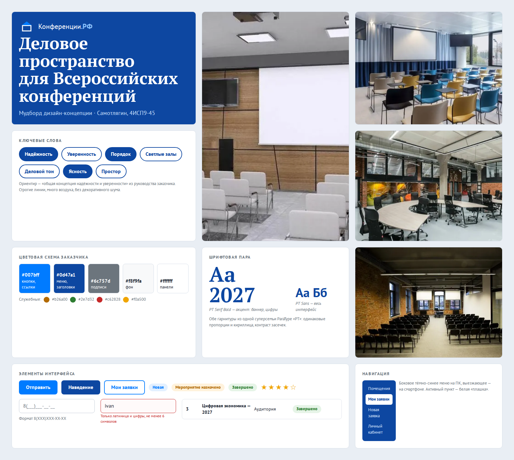
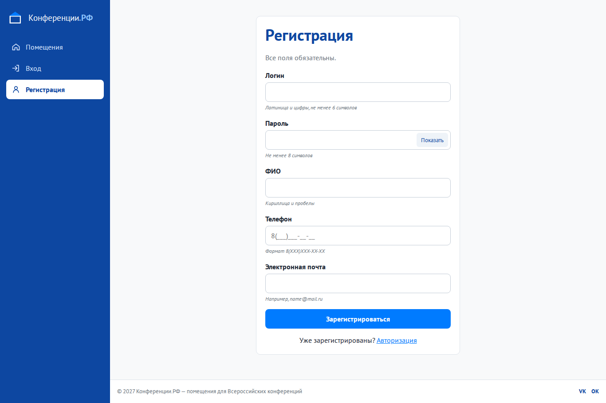
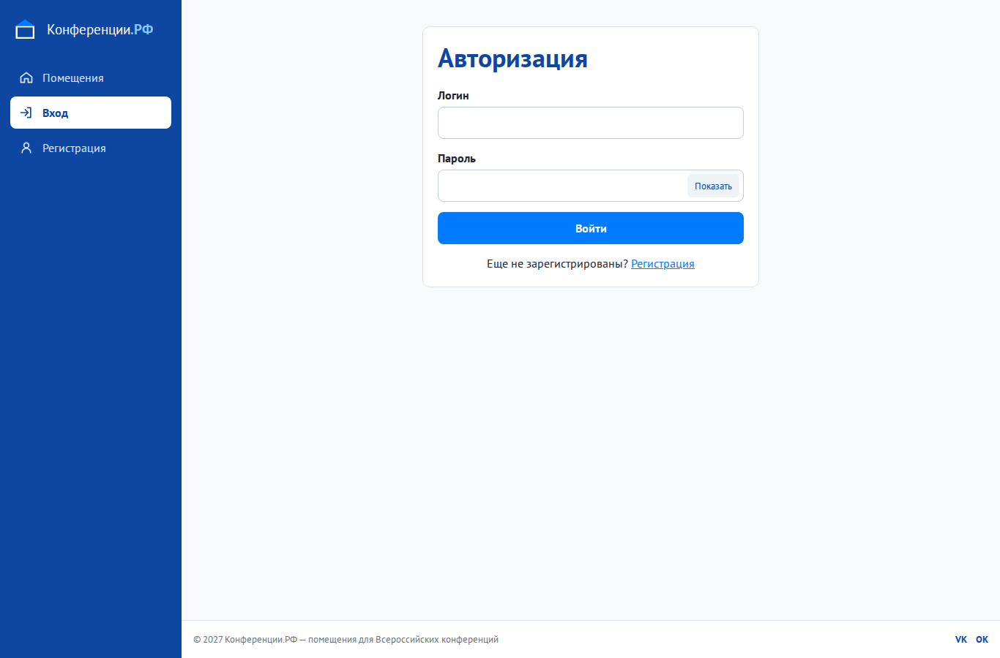
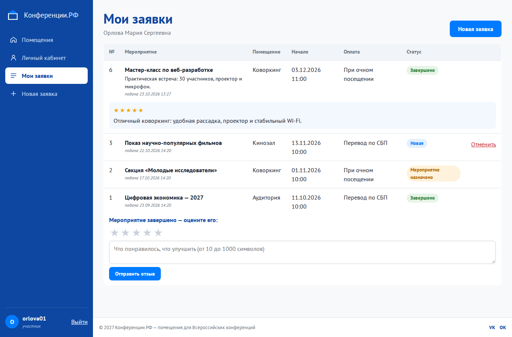
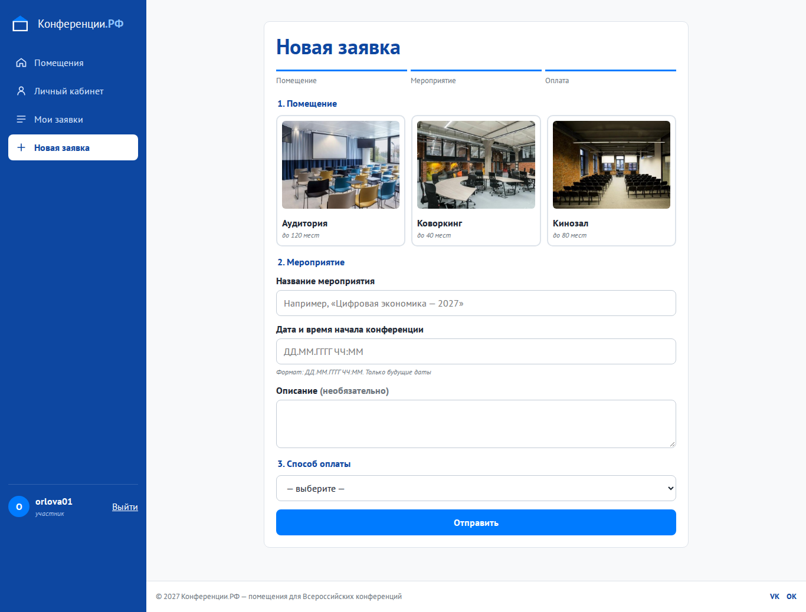
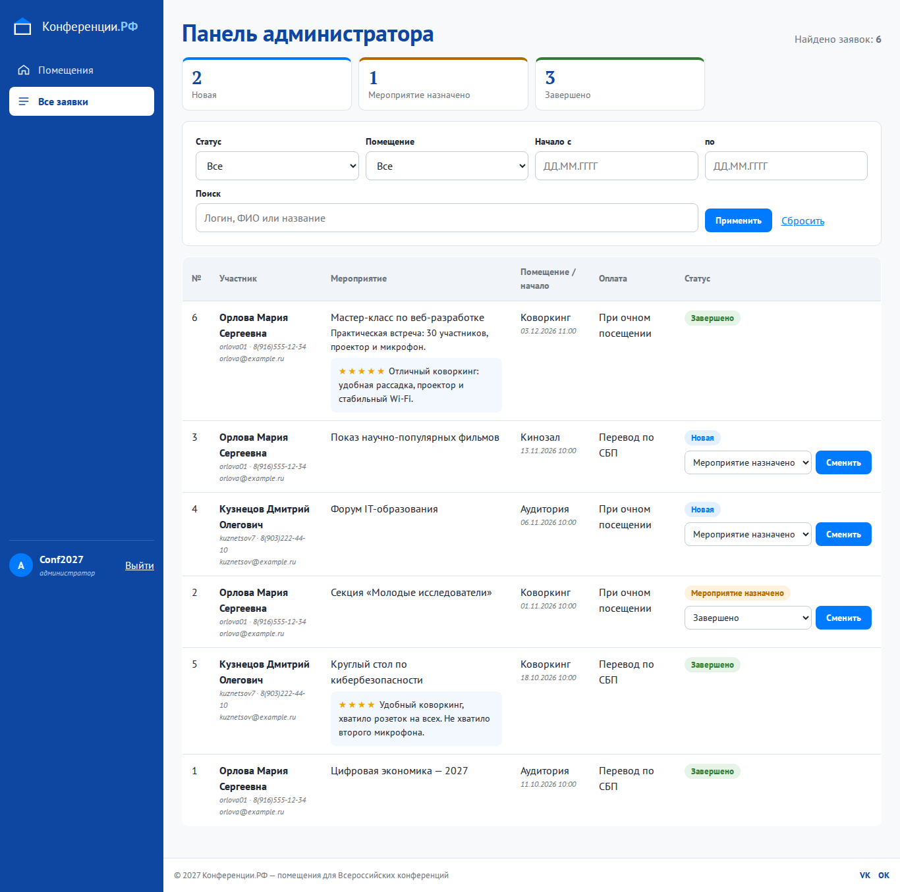
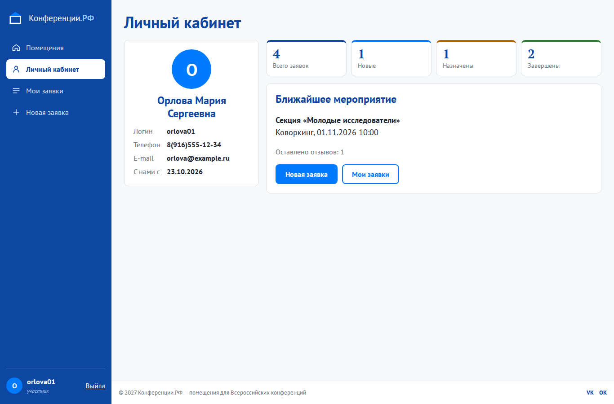

# Практическая работа № 7. Разработка дизайн-концепций веб-приложений

**Студент:** Самотлягин, группа 4ИСП9-45

**Цель:** разработать дизайн-концепцию портала «Конференции.РФ» в соответствии с корпоративным стилем заказчика.

| Файл | Что это |
|---|---|
| `moodboard.png` | мудборд |
| `moodboard.html` + `assets/` | исходник мудборда (открыть в браузере) |
| `maket_1…6_*.png` | 6 макетов страниц из списка ПР 6, ПК 1366×900 |
| `screenshot.png` | общий вид главной страницы |

## 1. Мудборд

Настроение — **«деловое пространство»**. На мудборде:

- фото трёх помещений и баннера из медиаматериалов к заданию;
- ключевые слова: надёжность, уверенность, порядок, светлые залы, деловой тон, ясность, простор;
- палитра, шрифтовая пара, базовые элементы интерфейса и схема навигации.

## 2. Цветовая схема

Основа — пять цветов из «Руководства по стилю» заказчика:

| Цвет | HEX | Роль |
|---|---|---|
| Голубой | `#007bff` | основные кнопки, ссылки, фокус, бейдж «Новая» |
| Тёмно-синий | `#0d47a1` | боковое меню, заголовки, логотип, наведение на кнопки |
| Серый | `#6c757d` | подписи, подсказки, заголовки столбцов |
| Фон | `#f8f9fa` | фон рабочей области |
| Белый | `#ffffff` | панели, таблицы, формы |

Служебные цвета подобраны в тон палитре:

- `#b26a00` — «Мероприятие назначено»;
- `#2e7d32` — «Завершено»;
- `#c62828` — ошибки;
- `#f0a500` — звёзды рейтинга.

Контраст основного текста к фону — не ниже 4.5 : 1.

## 3. Шрифтовая пара

| Шрифт | Где | Почему |
|---|---|---|
| **PT Sans** (по стилю заказчика) | весь интерфейс: H1 36 px, H2 24 px, H3 18 px Bold, текст 16 px, подсказки 12 px Italic | хорошая кириллица, читается в мелком размере |
| **PT Serif Bold** (акцентный) | крупный заголовок баннера, цифры счётчиков | засечки дают «солидность» и выделяют главное |

Обе гарнитуры из суперсемьи ParaType «PT»: высота строчных и пропорции у них совпадают, поэтому шрифты не спорят друг с другом. Контраст получается за счёт засечек. Оба шрифта под лицензией OFL и подключены локально в WOFF2.

## 4. Макеты страниц

Концепция интерфейса:

- **рабочая панель**: тёмно-синее боковое меню слева и светлая рабочая область справа;
- данные показаны **таблицами** (на телефоне — карточками), потому что администратору важна плотность информации;
- скругления 8–10 px и тонкие рамки вместо теней — строгий деловой стиль.

| 1. Регистрация | 2. Авторизация | 3. Просмотр заявок |
|---|---|---|
|  |  |  |

| 4. Создание заявки | 5. Панель администратора | 6. Личный кабинет |
|---|---|---|
|  |  |  |

## 5. Согласование с корпоративным стилем

| Требование стиля | Проверка |
|---|---|
| Только цвета палитры для основных элементов | ✅ меню, кнопки, заголовки, фон — из пяти цветов заказчика |
| Шрифт PT Sans, размеры H1/H2/H3/текст/подсказки | ✅ заданы в `app.css`; PT Serif только как акцент |
| «Надёжность и уверенность» | ✅ симметрия, выравнивание по сетке, без ярких градиентов и анимаций ради анимаций |
| Логотип | ✅ знак «здание» в фирменном тёмно-синем с голубой крышей |
| Медиаматериалы заказчика | ✅ фото помещений из приложения к КИМ, приведены к 4:3 и WebP |

Макеты сделаны сразу в HTML/CSS: это рабочие страницы приложения (`konf/views/*`), снятые на ПК 1366×900.
