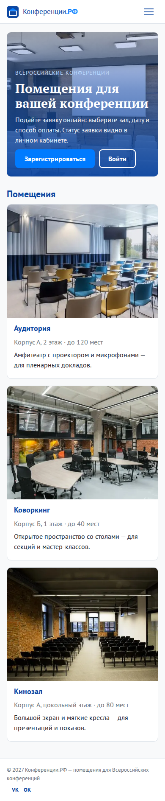
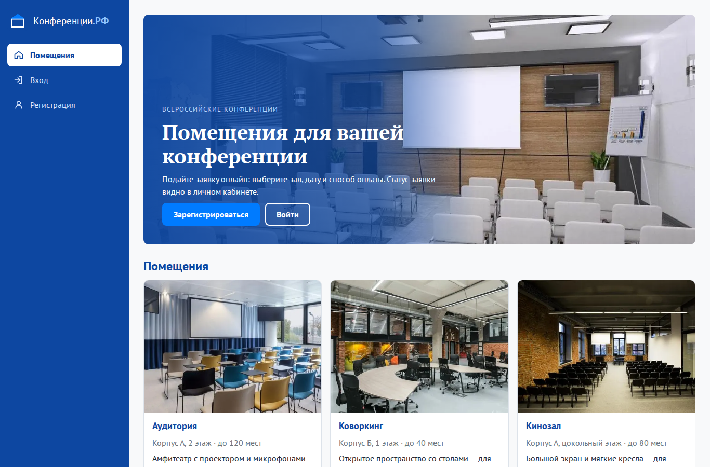
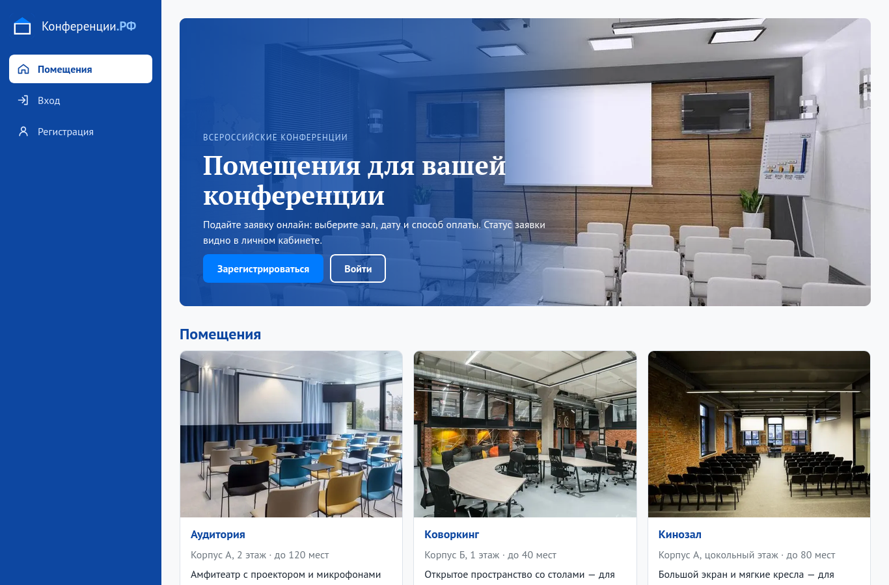
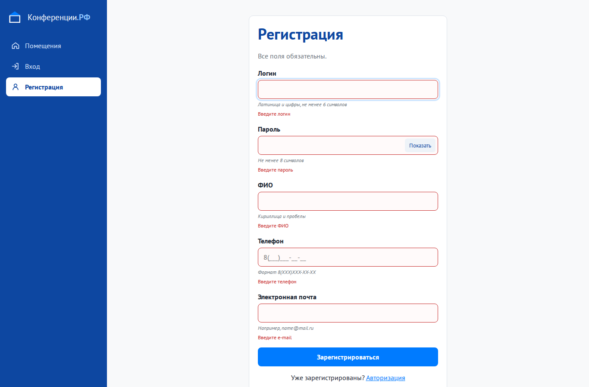
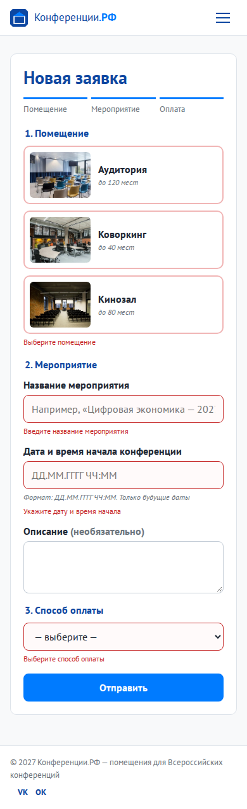
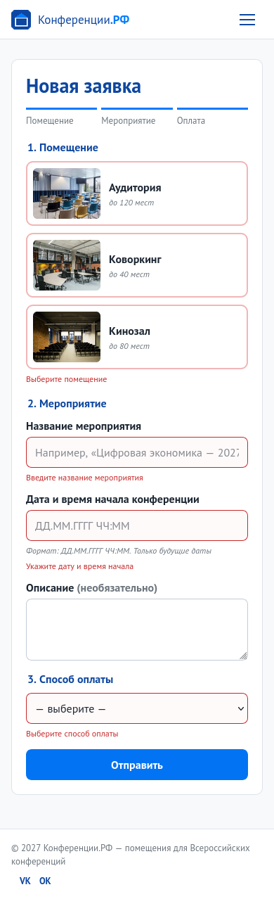

# Практическая работа № 10. Интерфейс пользователя

Студент: Самотлягин, группа 4ИСП9-45.

## Соответствие ТЗ

| Страница | Адрес | Шаблон | Что требует ТЗ |
|---|---|---|---|
| Главная | `/` | `home.php` | помещения с фото, кнопки «Зарегистрироваться» и «Войти» |
| Регистрация | `/register` | `register.php` | логин, пароль, ФИО, телефон, e-mail — все обязательные |
| Авторизация | `/login` | `login.php` | логин и пароль, «Неверный логин или пароль», ссылка «Еще не зарегистрированы? Регистрация» |
| Мои заявки | `/applications` | `applications.php` | только свои заявки со статусом, отзыв у завершённых |
| Новая заявка | `/applications/new` | `application_new.php` | помещение, дата и время начала, способ оплаты, кнопка «Отправить» |
| Личный кабинет | `/profile` | `profile.php` | профиль и сводка по заявкам |
| Панель администратора | `/admin` | `admin.php` | все заявки, фильтры, смена статуса |
Сделаны главная страница, регистрация, вход, список заявок, новая заявка, личный кабинет и панель администратора. Шаблоны находятся в `konf/views`, стили — в `konf/public/assets/css/app.css`, скрипт — в `konf/public/assets/js/app.js`.

## Вёрстка

На ПК слева находится постоянное меню. При ширине меньше 992 px оно открывается кнопкой в верхней панели. На телефоне таблицы превращаются в карточки с подписями полей, помещения располагаются в одну колонку.

У полей есть подписи и сообщения об ошибках. Логин, пароль, ФИО, телефон и почта проверяются до отправки и повторно на сервере. Дата и время вводятся как `ДД.ММ.ГГГГ ЧЧ:ММ`; поля дат в фильтре администратора — как `ДД.ММ.ГГГГ`.

## Проверка в браузерах

Страницы проверены в Chromium 153 и Firefox 153 на размерах 1366×900 и 390×844. В каждом браузере открыты главная, регистрация, заявки, новая заявка, профиль и панель администратора.

| Проверка | Chromium | Firefox |
|---|---|---|
| Горизонтальная прокрутка на 390 px | Нет | Нет |
| Пустая регистрация | 5 ошибок | 5 ошибок |
| Пустая заявка | 4 ошибки | 4 ошибки |
| Ошибки JavaScript | Нет | Нет |
| Отображение даты во вводе | ДД.ММ.ГГГГ ЧЧ:ММ | ДД.ММ.ГГГГ ЧЧ:ММ |

Результаты записаны в browser_checks.json. Имена снимков состоят из названия браузера, размера и страницы: например, firefox_mobile_new.png.

## Снимки

| Chromium: ПК | Firefox: ПК |
|---|---|
|  |  |
|  |  |

| Chromium: форма заявки на телефоне | Firefox: форма заявки на телефоне |
|---|---|
|  |  |

Проверка касается перечисленных страниц и сценариев в этих двух браузерах.
