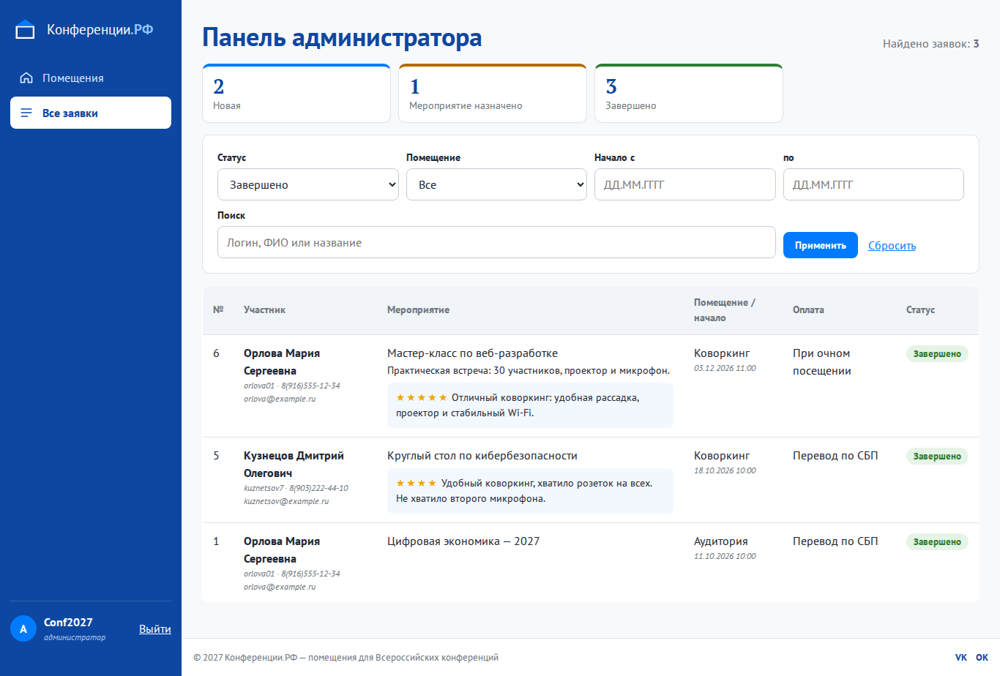
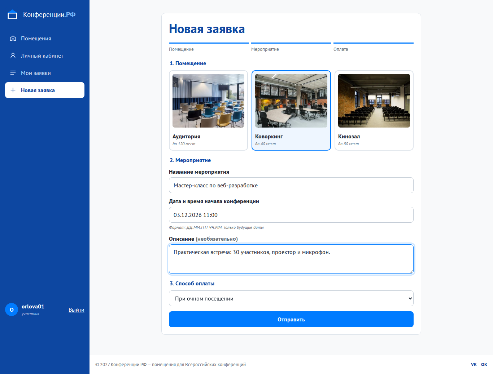
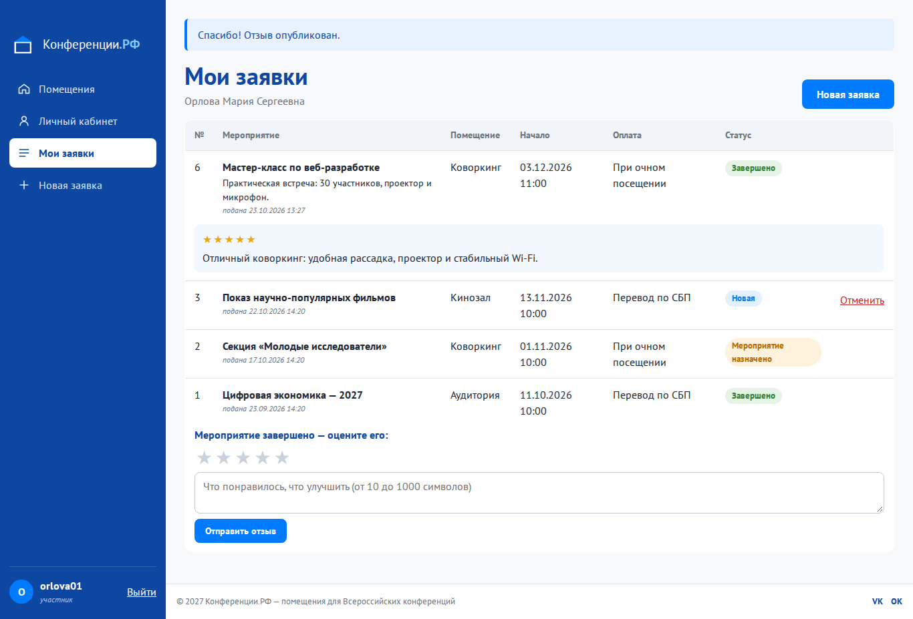

# Практическая работа № 11. Разработка веб-приложения в соответствии с ТЗ

**Студент:** Самотлягин, группа 4ИСП9-45

**Цель:** разработать работающее веб-приложение «Конференции.РФ» с полным функционалом.

**Стек:**

- PHP без фреймворков;
- PDO;
- SQLite (для разработки) или MySQL 8 (для сервера);
- HTML, CSS, JavaScript.

Код лежит в [`../konf`](../konf).

## 1. Интеграция фронтенда и бекенда

Все запросы идут через одну точку входа `public/index.php` (front controller). Она по таблице маршрутов вызывает метод контроллера:

```
Браузер ──форма POST / ссылка GET──▶ public/index.php ──▶ Controller ──▶ Repo (SQL через PDO) ──▶ БД
   ▲                                                         │
   └──────────── HTML из шаблона views/*.php ◀──────────────┘   (после POST — редирект 302, PRG)

```

| Часть | Файлы | Роль |
|---|---|---|
| Фронтенд | `views/*.php`, `public/assets/css/app.css`, `public/assets/js/app.js` | разметка, стили, проверка форм в браузере |
| Контроллеры | `src/Controller/*Controller.php` | принимают запрос, проверяют CSRF и права, вызывают репозитории, выбирают шаблон |
| Работа с БД | `src/Db.php`, `src/Repo/*.php` | подготовленные SQL-запросы, транзакции |
| Безопасность | `src/Auth.php`, `src/Http.php`, `src/Validator.php` | вход и роли, CSRF, серверная валидация |

Формы работают и **без JavaScript**: сервер повторно проверяет все поля и возвращает форму с ошибками (код 422). JS только ускоряет проверку на клиенте.

## 2. Работа с БД — CRUD

| Операция | Где в интерфейсе | SQL (файл) |
|---|---|---|
| **Create** | регистрация; новая заявка (в транзакции создаются `event` и `application`); отзыв | `INSERT INTO users / event / application / review` (`Users.php`, `Applications::create`, `Reviews::add`) |
| **Read** | «Мои заявки», панель администратора с фильтрами, личный кабинет, справочники | `SELECT … JOIN event, room, status, payment_type, users LEFT JOIN review` (`Applications::forUser/search/stats`) |
| **Update** | смена статуса заявки администратором | `UPDATE application SET status_id = ? WHERE id = ?` (`Applications::changeStatus`) |
| **Delete** | участник отменяет свою заявку в статусе «Новая» | `DELETE FROM event WHERE id = ?`, заявка удаляется каскадом (`Applications::cancel`) |

## 3. Смена статусов: новая → назначено → завершено

Разрешённые переходы заданы в `Applications::NEXT`:

```php
self::NEW      => [self::ASSIGNED, self::DONE],
self::ASSIGNED => [self::DONE],
self::DONE     => [],
```

- В админке в списке у каждой заявки только допустимые следующие статусы. У завершённой списка нет совсем.
- Сервер проверяет переход ещё раз. Попытка вернуть статус назад (например, подменой формы) даёт ошибку «Статус можно менять только вперёд».

## 4. Отзывы после завершения мероприятия

- Форма отзыва (звёзды 1–5 и текст от 10 символов) появляется у участника только у заявок в статусе «Завершено».
- Сервер (`Reviews::add`) проверяет:
  - заявка принадлежит этому участнику;
  - статус «Завершено»;
  - отзыва по этой заявке ещё нет — это гарантирует и `UNIQUE` в БД;
  - оценка от 1 до 5, длина текста.
- Опубликованный отзыв участник видит в своей заявке, а администратор — в карточке заявки.

## 5. Полный сценарий (скриншоты)

| Шаг | Кто | Что происходит | Скриншот |
|---|---|---|---|
| 1 | участник | заполняет заявку: коворкинг, «Мастер-класс по веб-разработке», 03.12.2026 11:00, очная оплата | `1_create_form.png` |
| 2 | участник | заявка № 6 создана, статус «Новая» | `2_created.png` |
| 3 | администратор | «Новая» → «Мероприятие назначено» | `3_status_assigned.png` |
| 4 | администратор | «Мероприятие назначено» → «Завершено» | `4_status_done.png` |
| 5 | участник | у завершённой заявки появилась форма отзыва, ставит 5 звёзд | `5_review_form.png` |
| 6 | участник | отзыв опубликован | `6_review_published.png` |
| 7 | администратор | фильтр «Завершено», отзыв виден в карточке | `7_admin_review_filter.png` |



| Создание заявки | Отзыв опубликован |
|---|---|
|  |  |

## 6. Проверка работы

Регистрация, вход, отправка заявки, смена статусов и публикация отзыва проверены на текущей версии приложения. По ходу сценария сделаны снимки, перечисленные выше.

Дата и время во всех формах вводятся в формате ДД.ММ.ГГГГ ЧЧ:ММ. Телефон из 11 цифр принимается также при выключенном JavaScript.
